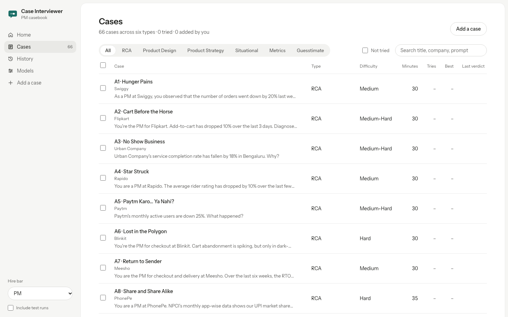
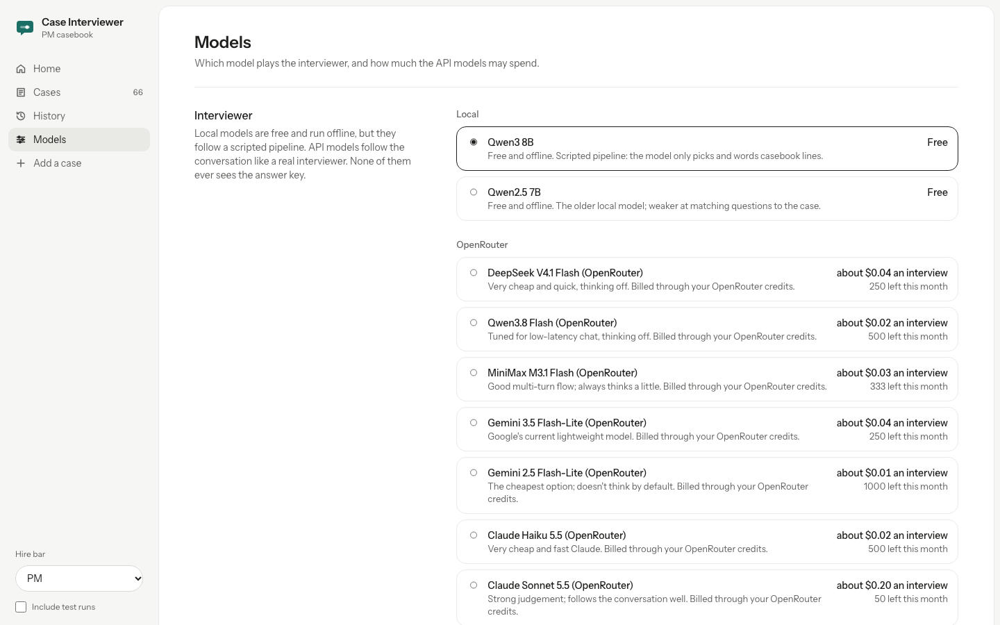

# PM Case Interviewer

A mock product-management case interviewer that runs on your own computer. It interviews you on a real case, by voice or text, reveals data only when you ask for it, and then grades the transcript against research-backed rubrics with a hire-bar verdict.

It ships with **66 cases across 6 types** (root cause analysis, product design, product strategy, guesstimates, metrics, situational), mostly set in Indian consumer tech: Swiggy, Zomato, Flipkart, Blinkit, Meesho, PhonePe and others.

- **Local-first.** The interviewer and grader run through [Ollama](https://ollama.com) on your machine. No account, no cost, works offline.
- **Optional API interviewers.** Claude, Gemini, DeepSeek, Qwen, MiniMax, or OpenRouter, under a hard monthly spending cap that is checked before every call.
- **Doesn't give the answer away.** The interviewer never sees the answer key. Its replies are checked in code, so it can't volunteer facts, interpret numbers for you or coach.
- **Grades like a rubric, not a vibe.** One pass per dimension, verbatim quotes checked against your transcript, gates and weights applied in code, and a verdict at APM, PM or senior PM level.





## Quick start

You need Python 3.10+ and [Ollama](https://ollama.com/download).

```bash
git clone https://github.com/athul-2/pm-case-interviewer.git
cd pm-case-interviewer
pip install -r requirements.txt
ollama pull qwen3:8b
ollama pull nomic-embed-text
python3 -m interviewer.server
```

Then open http://127.0.0.1:8770.

**Less than 16 GB of RAM?** Use a smaller model. See [Choosing models for your machine](docs/USER_MANUAL.md#choosing-models-for-your-machine):

```bash
ollama pull qwen3:4b
INTERVIEW_MODEL=qwen3:4b GRADER_MODEL=qwen3:4b python3 -m interviewer.server
```

The [user manual](docs/USER_MANUAL.md) covers installation on macOS, Windows and Linux, voice setup, API models and the budget, running an interview, reading the report, adding your own cases, and troubleshooting.

## How it works

```
 you ──► interviewer ──────────► transcript ──► grader ──────────► report
         sees: prompt,                            sees: answer key,
         clarifying answers,                      rubric per case type,
         exhibits, twists                         your quoted turns
         never: the answer
```

1. **Each case is split in two.** The interviewer pack holds the prompt, prepared answers, data tables and follow-up twists. The grader pack holds the walkthrough, the answer, pitfalls and guardrails. The interviewer only ever sees the first.
2. **The interviewer is kept on a short leash.** It gives the smallest true answer to exactly what you asked. Code then removes offers of other data, conclusions ("so the drop is on the product page"), numbers inside hints, and tables read aloud. In product design cases, users, segments and pain points are yours to propose, so it asks for your guess before confirming.
3. **Help is logged.** If you're stuck, help escalates from a nudge to a redirect to a rescue, and each level costs points in grading.
4. **The grader** scores each rubric dimension separately on a 1-4 scale. It takes the expected value of the model's score probabilities and checks every supporting quote against your actual words. Weights, gates ("dived into data before structuring"), hint penalties and the verdict are computed in Python, never by the model.

The rubrics come from [research/report.md](research/report.md), a review of how interviewers at Indian and US tech companies assess each case type. No company publishes numeric weights, so each one is tagged with its source.

## Project layout

```
interviewer/     the app: engine.py and agent.py (interviewers), evaluator.py (grader), server.py + web/ (UI)
casebook/        66 cases as JSON, plus frameworks.md
research/        the evaluation research the rubrics are built from
custom_cases/    cases you add in the app (not committed)
sessions/        your transcripts and reports (not committed)
launcher/        optional macOS double-click launcher
docs/            user manual and decision log
```

## Status

The interview engine, grader, web app, CLI and API interviewers all work. Voice works but has had little real-mic testing. The grader separates strong, mid-level and weak scripted candidates on all 6 case types. It has not yet been calibrated against human scores, so treat verdicts as a practice signal, not a hiring prediction. See [docs/DECISIONS.md](docs/DECISIONS.md) for how the design got here.

The cases are practice material. Data marked "illustrative" in them is invented for teaching, and company figures are as of late 2026.

## License

[MIT](LICENSE). Company names in the cases belong to their owners; the cases are independent practice material, not affiliated with or endorsed by those companies.
